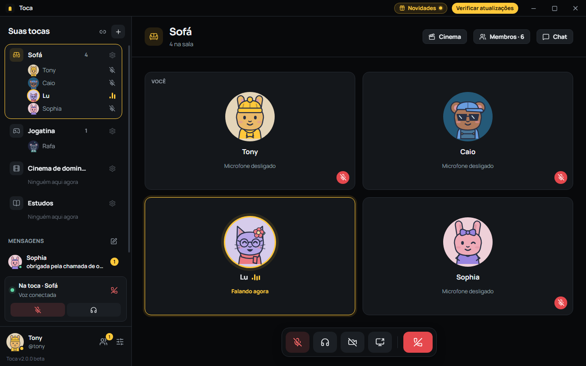
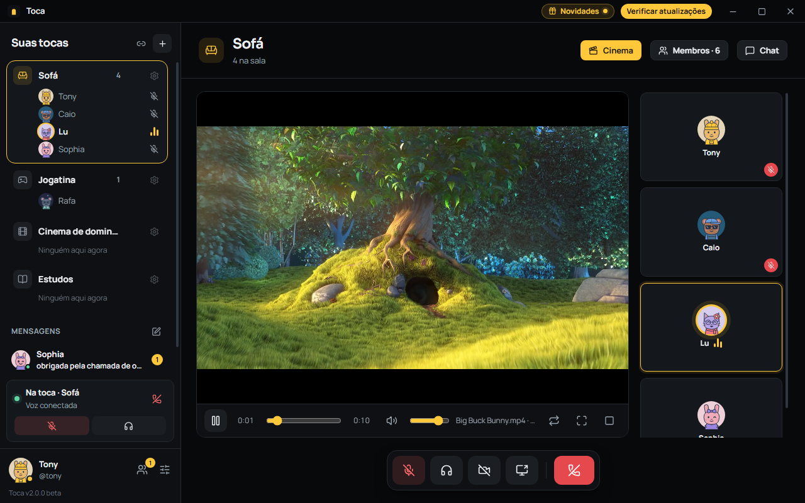
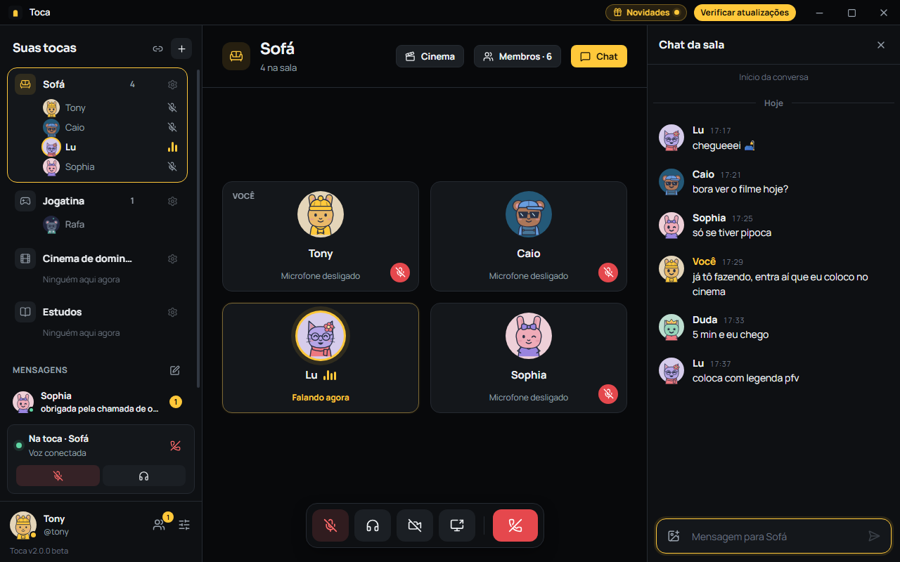
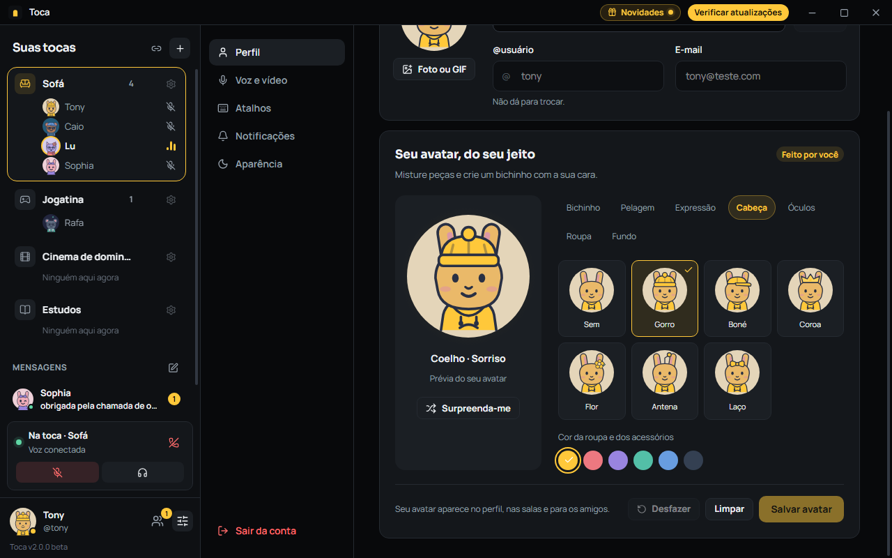
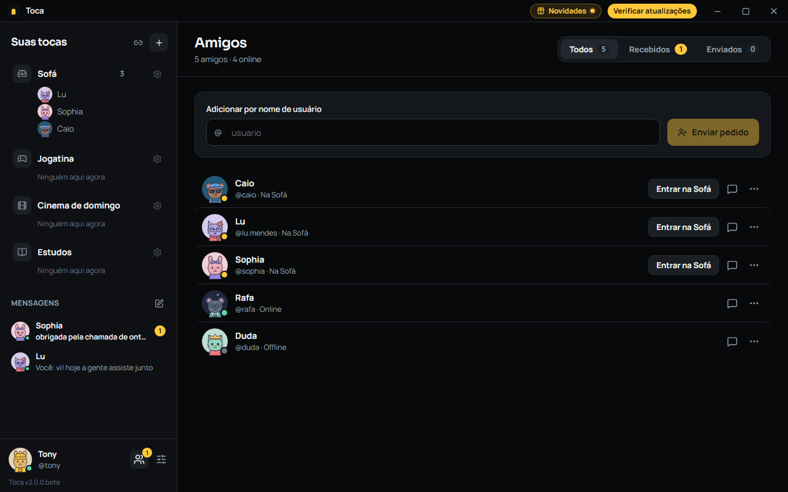
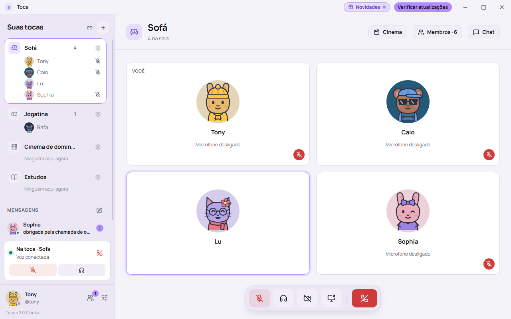
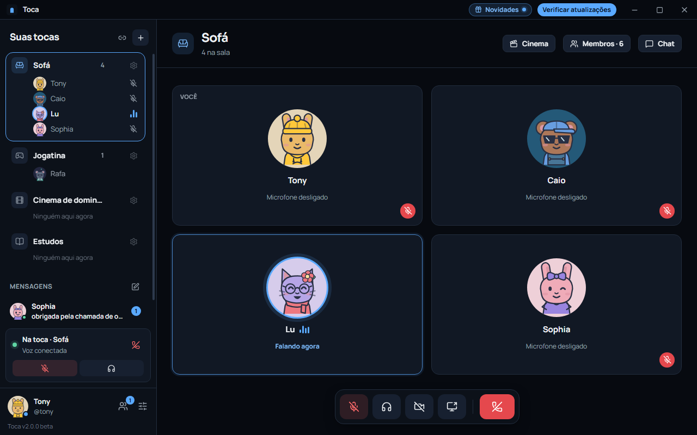
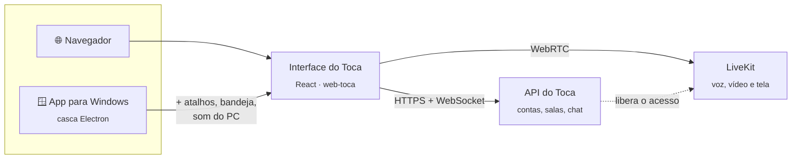

<div align="center">


# Toca

**A sala da turma, sempre aberta.**

Chamada de voz para amigos e casais, com salas fixas, tela compartilhada com som,<br>
sessão de cinema sincronizada e um bichinho com a sua cara.

[**Usar no navegador**](https://web-toca.rabbitapps.com.br) &nbsp;·&nbsp;
[**Baixar para Windows**](https://toca.rabbitapps.com.br) &nbsp;·&nbsp;
[Site](https://toca.rabbitapps.com.br)

[](https://github.com/tonyalbert/toca-releases/releases/latest)
[](LICENSE)


<br>



</div>

<br>

## A ideia

O Toca **não quer ser outro Discord**. Não tem comunidades, servidores abertos nem canais e
cargos para configurar. É um lugar simples para você e a sua turma: cada grupo tem as suas salas
fixas (o Sofá, a Jogatina, o Cinema de domingo) e você vê quem está em cada uma antes de entrar.
É clicar e já sair falando.

<br>

## O que dá para fazer

<table>
<tr>
<td width="50%" valign="top">

### 🎬 Assistir junto

Abra o **Cinema** na chamada e coloque um vídeo do YouTube ou um arquivo do seu PC. Play, pausa e
pulos valem para todo mundo, e quem chega no meio cai no ponto certo.

</td>
<td width="50%" valign="top">

### 💬 Conversar com o chat do lado

Cada sala tem o seu chat, com imagens (é só colar com Ctrl+V), e você conversa com a chamada
aberta. Também tem mensagens diretas entre amigos.

</td>
</tr>
<tr>
<td></td>
<td></td>
</tr>
<tr>
<td width="50%" valign="top">

### 🐰 Um bichinho com a sua cara

Coelho, gato ou urso, com pelagem, expressão, chapéu, óculos, roupa e fundo do seu jeito. Ou uma
foto, ou um **GIF que só se mexe enquanto você fala**.

</td>
<td width="50%" valign="top">

### 👥 A turma toda à vista

Amigos pelo @usuário, quem está online e em qual sala, pedidos de amizade e um clique para entrar
na sala de alguém.

</td>
</tr>
<tr>
<td></td>
<td></td>
</tr>
</table>

### 🎨 Do seu jeito

Seis cores (Meia-noite, Oceano, Floresta, Lavanda, Morango e Pôr do sol), cada uma no escuro e no
claro.

<table>
<tr>
<td width="50%"></td>
<td width="50%"></td>
</tr>
</table>

### E mais

- **Tela compartilhada com som**: a tela inteira ou uma janela, até 1080p a 30 fps, com o áudio do PC junto.
- **Voz limpa**: redução de ruído, sensibilidade automática do microfone e indicador de quem está falando na hora.
- **Convite por link**: vale por 1 hora ou para sempre. Vazou? Gere outro e o antigo para de funcionar.
- **Adm da sala**: o dono escolhe quem ajuda a cuidar da sala, e pode passar a sala para outra pessoa.
- **Apertar para falar e atalhos globais**: funcionam mesmo com o jogo em foco (no app para Windows).
- **Aba Novidades**: o que mudou em cada versão, direto no app.

<br>

## Navegador ou Windows?

Os dois usam a mesma conta e as mesmas salas, e dá para misturar: metade da turma no navegador e
metade no app.

| | 🌐 Navegador | 🪟 App para Windows |
|---|:---:|:---:|
| Salas, voz, chat, cinema e avatar | ✅ | ✅ |
| Instalar | não precisa | instalador de 100 MB |
| Compartilhar a tela | ✅ | ✅ |
| Som do PC junto com a tela | de uma aba ou da tela inteira (Chrome e Edge) | ✅ de qualquer programa |
| Apertar para falar | com a aba em foco | ✅ mesmo com o jogo em foco |
| Atalhos globais e bandeja | | ✅ |

<br>

## Como funciona

O app de Windows é uma **casca**, como o do Discord: ele abre o app web e só acrescenta o que o
navegador não faz. Assim, uma mudança na interface chega para todo mundo com um deploy, sem
precisar baixar versão nova.



- **Este repositório** é o app: a interface (React) e a casca (Electron).
- **A API** (contas, amigos, salas e mensagens) é um projeto separado e não é código aberto.
  Compilando este código, você entra com a sua conta normal do Toca.
- **Voz, vídeo e tela** passam pelo [LiveKit](https://livekit.io) (WebRTC), com o acesso liberado
  pela API.

**Feito com** Electron · React 19 · TypeScript · Vite · LiveKit · nginx.

<br>

## Para quem desenvolve

Precisa de **Node.js 22** ou mais novo. O app para Windows precisa de **Windows 10 ou 11**.

```bash
npm install
npm run dev:web     # app web em http://localhost:5173
npm run dev         # app para Windows (Electron) com a interface local
```

Por padrão, o app conversa com a API oficial. Para usar outra, copie `.env.example` para `.env`
e troque `VITE_API_URL`.

<details>
<summary><b>Outros comandos</b></summary>

```bash
npm run typecheck   # confere os tipos (casca e interface)
npm run build:web   # app web em dist-web/ (site estático + version.json)
npm run build       # casca em out/
npm run dist        # instalador do Windows em dist/ (sem publicar)
```

O `npm run dev` e o `npm run dist` também compilam o `toca-audio-capture.exe` (som do PC ao
compartilhar a tela) com o compilador C# que já vem no Windows: não precisa de Visual Studio
nem .NET SDK.

</details>

<details>
<summary><b>Navegador ou Electron: a camada de plataforma</b></summary>

A interface descobre onde está rodando em `src/renderer/src/platform/`. No Electron, ela usa
`window.toca` (entregue pelo preload); no navegador, usa as versões web:

- **Sessão**: no Windows, o refresh token fica guardado pelo próprio Windows (`safeStorage`); no
  navegador, num cookie httpOnly da API, que o JavaScript da página não lê.
- **Compartilhar a tela**: seletor do Toca + som do PC (Windows) ou o seletor do navegador.
- **Apertar para falar**: global (Windows) ou com a aba em foco.

Use sempre `native.x()` e `features`. Se a casca instalada ainda não tiver uma função nova, a
interface cai na versão web em vez de quebrar.

</details>

<details>
<summary><b>A casca do Windows</b></summary>

- `src/main/shell.ts`: endereço do app, bloqueio de navegação (outros sites abrem no navegador
  padrão), conferência de quem chama o `ipcMain` e a tela "Sem conexão".
- O preload só entrega `window.toca` para o endereço do app.
- `TOCA_APP_URL=http://localhost:4173` aponta a casca para outro endereço em desenvolvimento (o
  app instalado sempre usa o oficial).

**Regra:** mudou só a interface, basta o deploy do app web. Mudou algo nativo (preload, processo
principal), é versão nova da casca, e a interface precisa funcionar sem ela.

</details>

<details>
<summary><b>Publicar o app web (Coolify)</b></summary>

1. **DNS**: aponte o domínio do app para o servidor.
2. **Novo recurso** → este repositório, branch `main`, build pack **Dockerfile** (o `/Dockerfile` da
   raiz), porta **80**. O nginx (`nginx/`) serve o app com cache longo para `assets/`, sem cache
   para `index.html` e `version.json`, e com cabeçalhos de segurança.
3. **Na API**: `APP_ORIGINS` com o endereço do app (separe vários com vírgula), para ele poder guardar
   a sessão em cookie; e o mesmo endereço em `CORS_ORIGINS`, se não for `*`.

Quando sai um build novo, quem está com o Toca aberto vê o botão "Atualizar" (recarrega a página,
esperando a chamada acabar).

</details>

<details>
<summary><b>Onde fica cada coisa</b></summary>

```
src/main/       casca do Electron: janela, bandeja, atalhos globais, atualização,
                links toca://, seletor de tela
src/preload/    ponte segura entre a casca e a interface
src/renderer/   interface em React (a mesma no navegador e no Windows)
  src/platform/        o que muda entre o Electron e o navegador
  src/api.ts           chamadas à API do Toca
  src/realtime.ts      eventos em tempo real (amigos, salas, mensagens)
  src/useVoiceRoom.ts  a chamada (LiveKit)
  src/cinema.ts        sessão de cinema sincronizada
  src/changelog.ts     a aba Novidades
src/shared/     tipos usados pelos dois lados
native/         captura do som do PC no Windows (C#)
nginx/          servidor do app web
design/         protótipos e tokens visuais
```

</details>

<br>

## Contribuindo

Issues e pull requests são bem-vindos. Antes de algo grande, abra uma issue para conversar sobre
a ideia: algumas mudanças dependem da API, que é mantida à parte.

Encontrou uma falha de segurança? Não abra uma issue pública: use **Security → Report a
vulnerability** aqui no GitHub.

## Licença

O código está sob a [GNU GPL v3](LICENSE): você pode usar, estudar, modificar e distribuir, desde
que as versões modificadas que você distribuir também tenham o código aberto, sob a mesma licença.

O nome **Toca**, o logo e o ícone não fazem parte da licença. Se publicar uma versão modificada,
use outro nome e outro ícone, para ninguém confundir com o app oficial.

<sub>Nos prints, o vídeo do cinema é <a href="https://peach.blender.org">Big Buck Bunny</a>
(© Blender Foundation, CC BY 3.0). As pessoas e conversas são de exemplo.</sub>

<div align="center"><br><sub>Feito com carinho pela <b>Rabbit</b> 🐰</sub></div>
