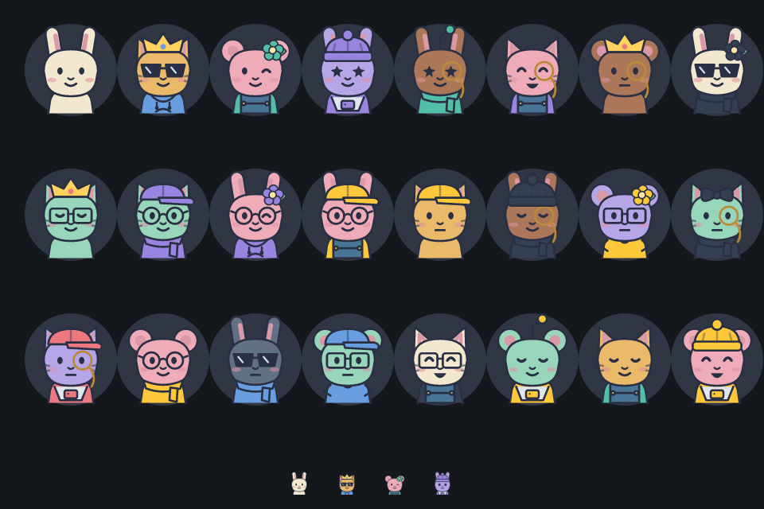

# Avatares personalizados

Abra Configurações > Perfil para montar seu avatar. Escolha bichinho, pelagem, expressão, peça de cabeça, óculos, roupa, cor das peças e fundo. A prévia é local: as alterações só são enviadas ao clicar em Salvar avatar. Desfazer restaura o avatar salvo; Limpar retira as personalizações mantendo a espécie; Surpreenda-me cria uma combinação aleatória.

São 3 espécies, 8 pelagens, 6 expressões, 7 opções de cabeça, 5 opções de óculos, 6 roupas, 6 cores de peças e 8 fundos. As combinações podem se repetir entre pessoas; não há reserva ou garantia de exclusividade.

## Dados e compatibilidade

Os valores antigos `rabbit`, `cat` e `bear` continuam aceitos. Novos avatares usam a receita compacta `v1:species:fur:face:hat:glasses:outfit:tone:background`. A API valida cada opção e o tamanho antes de salvar. As receitas são distribuídas pelos mesmos eventos `user_updated` usados por amigos e membros das salas, e aparecem nos cartões de chamada, barra lateral e perfil.

O contrato está em `desktop/src/renderer/src/avatar.ts` e `api/src/avatar.ts`. São cópias intencionais para permitir builds e deploys separados; o teste de contrato detecta divergências. Para adicionar peças, atualize ambos, os rótulos do editor e a arte SVG.

## Atualização em produção

1. Suba primeiro a API. A migration `20261010190000_avatar_personalizado` converte a coluna enum em `VARCHAR(120)` preservando todos os valores atuais. O Dockerfile da API já executa `prisma migrate deploy` ao iniciar.
2. Publique a nova versão do desktop. A API antiga rejeita receitas personalizadas; clientes antigos não desenham todas as peças novas.
3. Monte e salve um avatar no perfil e confira sua aparência em outra conta e em uma sala.

Para instalações sem Docker, execute `npm run db:deploy` na API antes de iniciar a versão nova.

## Validação

- API: `npm run build` e `npm run test:avatar`.
- Desktop: `npm run typecheck` e `npm run build`.

`test:avatar` não acessa banco nem usa credenciais. Testa formatos legados, ida e volta da receita, opções inválidas, consistência do contrato e a rota real PATCH /me com persistência e notificações simuladas.

## Teste no Electron

Com `api` e `desktop` lado a lado, execute `npm run build` na API e `npm run test:avatar` no desktop. O teste abre uma janela real do Electron com a tela de perfil, faz login com uma conta isolada em memória, seleciona uma coroa e clica em Salvar avatar. Ele verifica o preflight CORS do Chromium, o PATCH autenticado e a mensagem de sucesso. Não acessa o banco nem a sessão da sua conta.

Para reproduzir o bloqueio original, execute `node scripts/test-avatar-desktop.mjs --simulate-old-cors` no desktop. O teste restringe apenas sua API local a GET, HEAD e POST e confirma que aparece "Sem conexão com o servidor", sem o PATCH chegar à API.

A API precisa permitir `PATCH` e `DELETE` no CORS, além de `GET`, `HEAD`, `POST` e `OPTIONS`. O plugin de CORS, sem configuração explícita, permite apenas GET, HEAD e POST. Depois de atualizar essa configuração, faça um novo deploy da API no Coolify.

